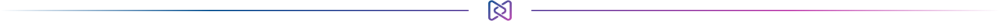

<div align="center">


<br/>

# RJ Nexus Documentation

**Guides, tutorials and developer references for RJ Nexus CMS and RJ Builder.**

<br/>


<br/>

[Read the Docs](https://rj-nexus.github.io/documents/) &nbsp;&bull;&nbsp; [Website](https://rjnexus.org) &nbsp;&bull;&nbsp; [Live Demo](https://rj-nexus.onrender.com) &nbsp;&bull;&nbsp; [RJ Nexus CMS](https://github.com/rj-nexus/rj-nexus) &nbsp;&bull;&nbsp; [Discussions](https://github.com/orgs/rj-nexus/discussions)

</div>



## About

This repository powers the official documentation site of **RJ Nexus**, an open-source, self-hosted CMS built on Laravel 12.

**Documentation:** [rj-nexus.github.io/documents](https://rj-nexus.github.io/documents/)

It is a static site served by GitHub Pages. There is no build step: add a Markdown page, register it in the documentation index, and push.

The repository also stores the shared images, SVG graphics and GIFs used by the READMEs across the RJ Nexus organization.


## What is documented

| Area | Topics |
|---|---|
| **Setup** | Getting Started, Installation, Manual Update |
| **Admin panel** | Language Settings and Translation, AI Setup (OpenRouter), Colors, Auto SEO, Caching, Notifications |
| **RJ Builder** | RJ Builder overview, Text Widget, Chinese Festivals Widget |
| **Development** | Custom Colors, Widget Development, Plugins, Theme Development |

The full and current list is always in the site menu: [rj-nexus.github.io/documents](https://rj-nexus.github.io/documents/).


## Repository structure

| Path | Purpose |
|---|---|
| `documents/` | The documentation site and its pages. Screenshots live in `documents/assets/photo/<topic>/`. |
| `assets/` | Shared SVG graphics, images and GIFs used in READMEs across the organization. |
| `lang/` | Language files. |
| `.github/workflows/` | GitHub Actions workflows. |
| `index.html` | Home page of the site. |
| `.nojekyll` | Tells GitHub Pages to serve the files as they are, without Jekyll. |

> **Please do not rename or move files in `assets/`.** Other repositories link to them directly through `raw.githubusercontent.com`, so a changed path breaks their banners and images.


## How the site works

The documentation page loads its menu and its content in the browser. The menu comes from the documentation index, a list of pages where each entry has a `title` and a `slug`. When a reader opens a page, the site loads the Markdown page that matches its slug and renders it.

This keeps the site simple: writing documentation means writing Markdown.

## Add or edit a page

1. Write the page in Markdown and save it in `documents/`. Use a short, lowercase file name that matches the slug, for example `notifications.md`.
2. Put screenshots in `documents/assets/photo/<topic>/` and name them `<topic>1.png`, `<topic>2.png` and so on. Reference them with a relative path and meaningful alt text.
3. Add the page to the documentation index with its `title` and `slug`.
4. Commit and push to `main`. GitHub Pages publishes the change in a few minutes.

### Writing guidelines

- Write in English, in short sentences.
- Keep page titles short.
- Start with what the feature is, then show how to use it step by step.
- Document only what you have verified in the product or in the code.
- Show real screens, and describe each screenshot in the alt text.
- Mention troubleshooting at the end of the page.

## Preview locally

Because the site loads its pages in the browser, open it through a local web server and not as a plain file:

```bash
git clone https://github.com/rj-nexus/rj-nexus.github.io.git
cd rj-nexus.github.io
python -m http.server 8000
```

Then open `http://localhost:8000/documents/`.


## Related repositories

| Repository | Description |
|---|---|
| [rj-nexus](https://github.com/rj-nexus/rj-nexus) | RJ Nexus CMS core |
| [spotlight](https://github.com/rj-nexus/spotlight) | A dark, builder-first theme with 25+ RJ Builder widgets |
| [rj-registration](https://github.com/rj-nexus/rj-registration) | Registry of themes and plugins |

## Contributing

Found a mistake, an outdated screenshot or a missing topic? Open an [issue](https://github.com/rj-nexus/rj-nexus.github.io/issues), send a pull request, or start a conversation in [GitHub Discussions](https://github.com/orgs/rj-nexus/discussions).

For bugs in the CMS itself, please use the [RJ Nexus repository](https://github.com/rj-nexus/rj-nexus).


<div align="center">

Created by **Ruhid Javadov** &nbsp;&bull;&nbsp; [rjnexus.org](https://rjnexus.org)

</div>
