# AI Setup (OpenRouter)

RJ Nexus uses [OpenRouter](https://openrouter.ai) to power its advanced AI features:

- **Auto SEO:** generates and audits SEO titles and descriptions.
- **AI Translation:** translates content while preserving HTML.
- **AI Code Review:** checks theme and plugin files for bugs and security risks.

OpenRouter gives you access to hundreds of AI models (ChatGPT, Claude, Gemini and more) through a **single API key**, so you can switch models at any time without changing anything else.

> **Video Guide:** Prefer a video walkthrough? [Watch the OpenRouter Setup Tutorial on YouTube](https://www.youtube.com/watch?v=3NwftLMKEWI).

**Time needed:** about 5 minutes.

## What you need

- An email address or a Google/GitHub account to sign up at OpenRouter.
- Access to your RJ Nexus admin panel (an Admin account).
- *(Optional)* A small credit balance on OpenRouter if you want to use paid models. Free models (their names end with `:free`) cost nothing, but they have usage limits.

## Contents

1. [Part 1: Creating an OpenRouter API key](#part-1-creating-an-openrouter-api-key)
2. [Part 2: Configuring RJ Nexus](#part-2-configuring-rj-nexus)
3. [Choosing a model](#choosing-a-model)
4. [Recommended settings](#recommended-settings)
5. [Keeping your key safe](#keeping-your-key-safe)
6. [Troubleshooting](#troubleshooting)

---

## Part 1: Creating an OpenRouter API Key

### 1. Create an account

Go to [openrouter.ai](https://openrouter.ai) and click **Sign Up** or **Sign In** in the top right corner.

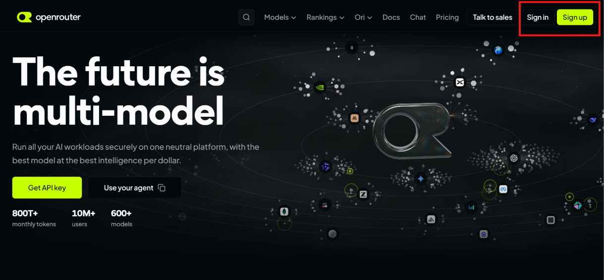

### 2. Open the Keys page

Once logged in, you will see the dashboard. In the sidebar, click **Keys** (highlighted in red).

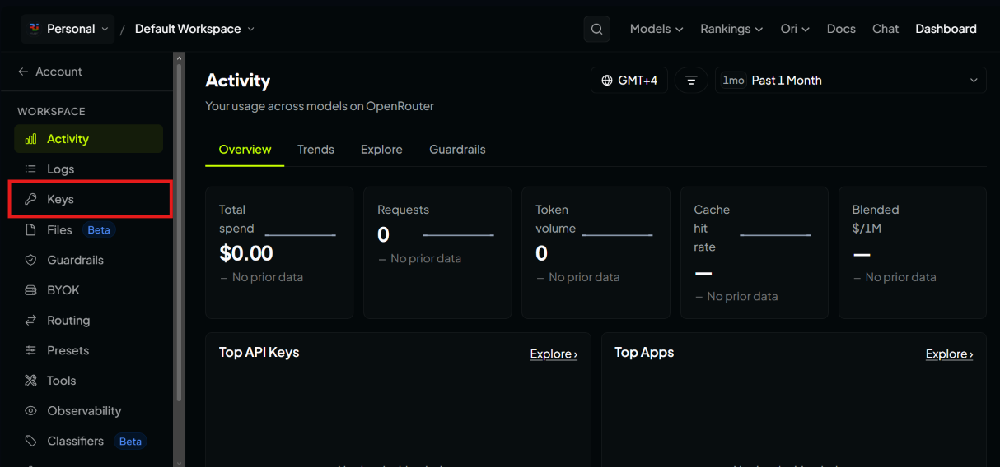

### 3. Create a new key

On the Keys screen, click the **New Key** button.

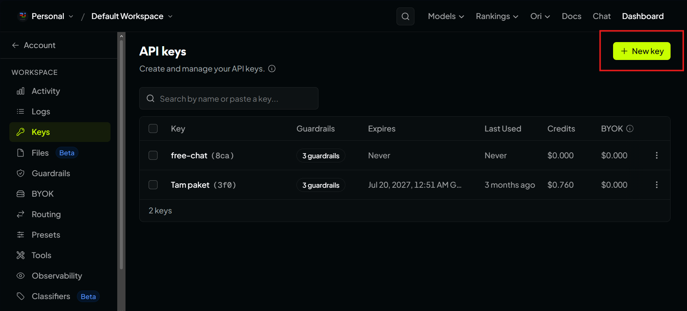

### 4. Configure the key

A window will appear where you can set:

| Field | What it does | Suggestion |
|-------|--------------|------------|
| **Name** | A label for the key | `RJ Nexus Site` |
| **Expiration** | When the key stops working | Leave empty, or set a date if you rotate keys regularly |
| **Credit limit** | Maximum spending for this key | Set a small limit (for example `$5`) to avoid surprise bills |

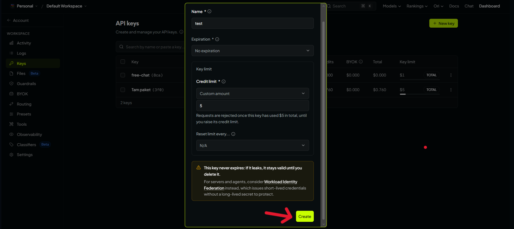
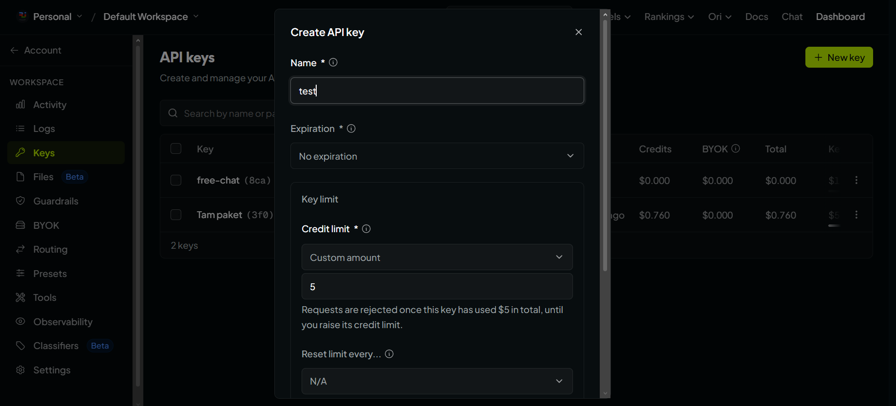

### 5. Copy your API key

Once created, your API key is shown on screen. **Copy it immediately** and store it somewhere safe, such as a password manager. OpenRouter will not show it again.

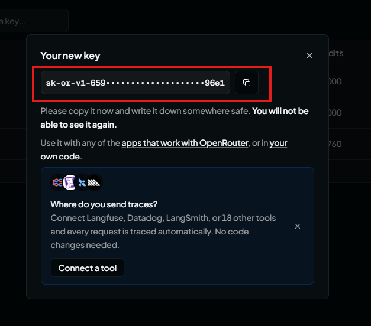

*(Optional)* You can manage your keys later by clicking them in the list. There you can view each key's configuration, limits and usage.

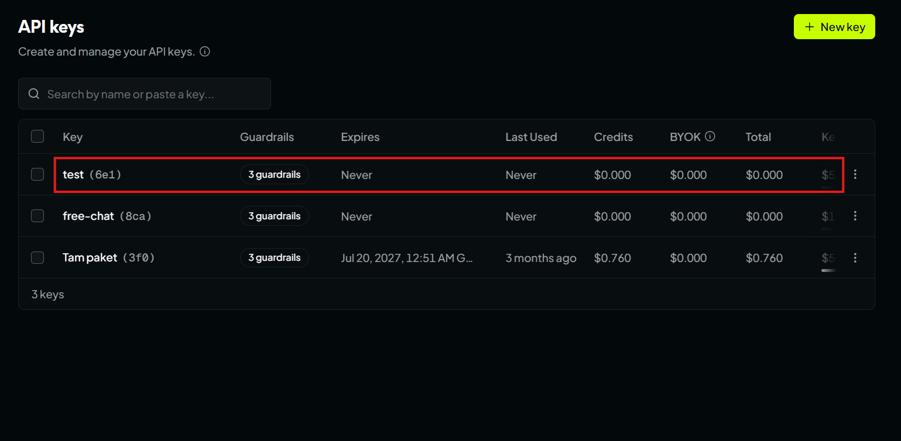
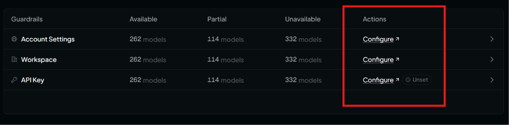

---

## Part 2: Configuring RJ Nexus

### 1. Open the AI settings

In the admin sidebar, open **Settings**.

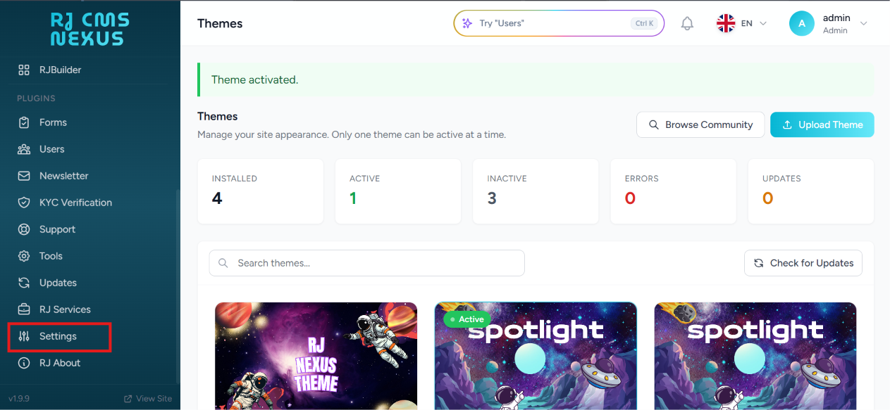

In the settings grid, click the **AI** card.

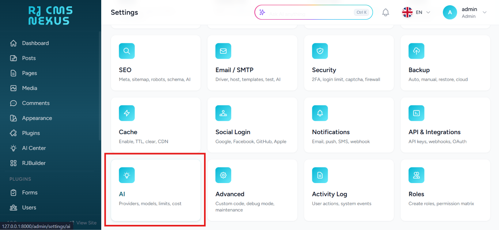

### 2. Paste your API key

Paste the key you copied from OpenRouter into the **API Key** field.

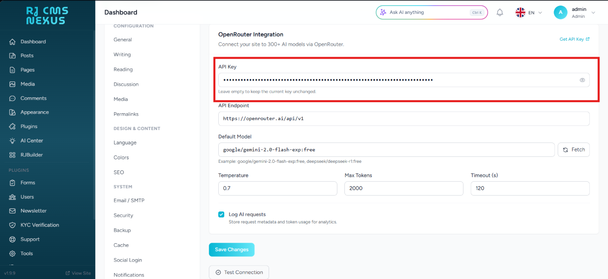

### 3. Understand the AI settings screen

This is the main AI configuration screen. Each colored box marks one section:

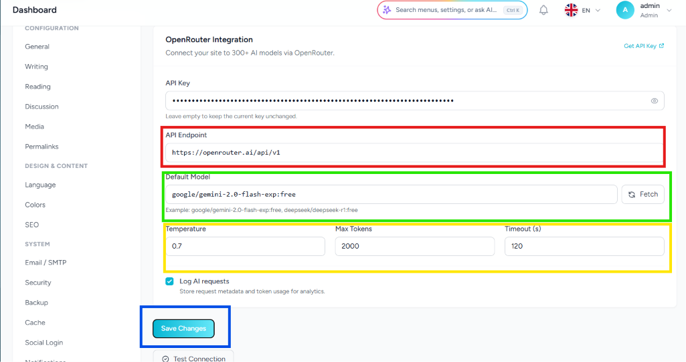

| Box | Section | What it does |
|-----|---------|--------------|
| Red | **API Endpoint** | The default OpenRouter URL. Do not change it unless OpenRouter changes its API address. |
| Green | **Default Model** | The AI model used by all features. Type a model name manually or use the **Fetch** button. |
| Yellow | **AI Parameters** | Controls how the AI behaves (see below). |
| Blue | **Save** | Saves your configuration. |

**AI Parameters**

- **Temperature:** lower values (for example `0.2`) make answers focused and predictable, higher values (for example `0.8`) make them more creative.
- **Max Tokens:** the maximum length of the AI's response.
- **Timeout:** how long to wait for a response before giving up.

### 4. Fetch and select a model

To load the list of available models, click **Fetch** next to the Default Model field.

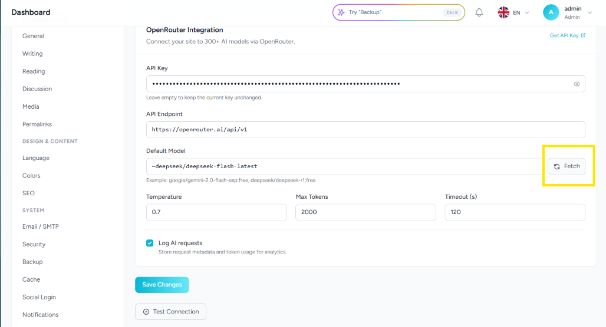

A dropdown list appears. Search for the model you want and select it (for example `google/gemini-2.0-flash-exp:free`).

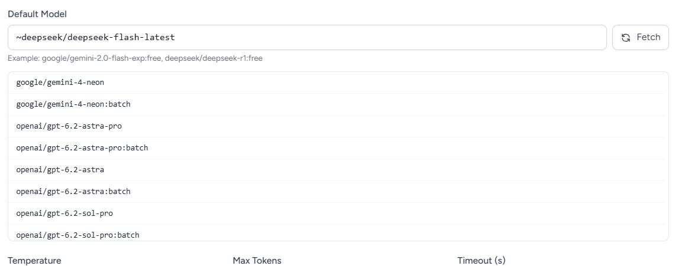

### 5. Check model pricing

To see what a model costs, click the **Get API Key** button (or the link next to the model list) to open the OpenRouter models page.

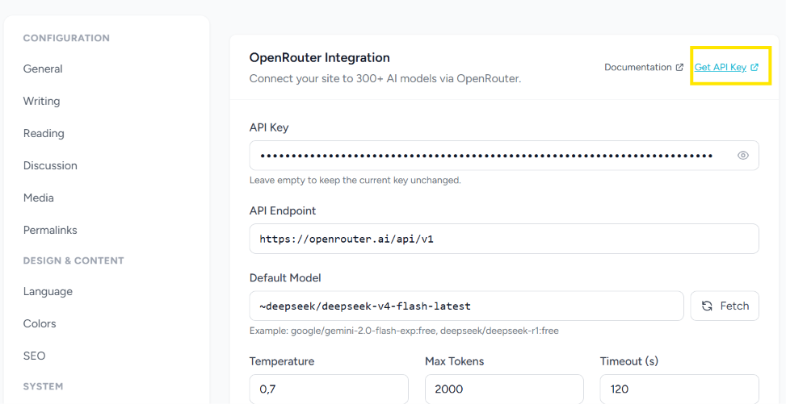

The model list shows pricing for each model:

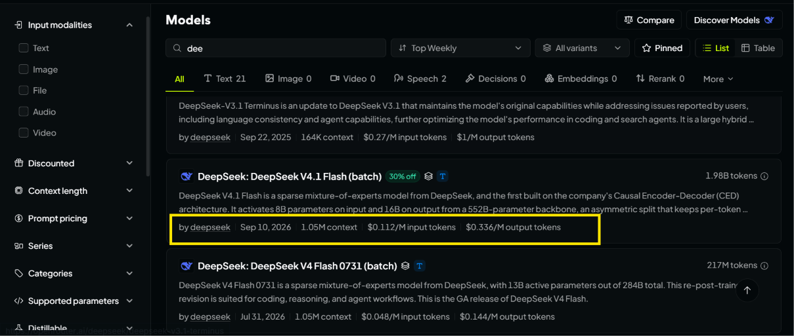

> **Example:** If a model says `$3/M input tokens` and `$15/M output tokens`, you pay $3 for every 1 million tokens you send to the AI and $15 for every 1 million tokens it generates. Free models show `$0`.

### 6. Save

After pasting the key and selecting a model, click **Save Changes** at the bottom of the page. The AI features are now active.

---

## Choosing a model

There is no single best model. Pick based on what you need:

| Goal | What to look for |
|------|------------------|
| Trying things out | A `:free` model. Zero cost, but slower and rate limited. |
| Everyday SEO and writing | A fast, low-cost model. Cheaper models are usually good enough. |
| Translation | A model that is strong in your target languages. Test with a short text first. |
| Code review | A larger model. It must return valid JSON, and weaker models sometimes do not. |

Tip: start with a free or cheap model, check the results, and upgrade only if the quality is not good enough.

## Recommended settings

These are starting points, not strict rules. Adjust them to your results.

| Setting | Suggested value | Notes |
|---------|-----------------|-------|
| Temperature | `0.2` to `0.4` | Best for SEO, translation and code review, where accuracy matters. Raise it for creative writing. |
| Max Tokens | `1500` or higher | Increase it if long answers or translations are cut off. |
| Timeout | `60` seconds or more | Large models and long texts can take a while to respond. |

## Keeping your key safe

Your API key lets anyone spend your OpenRouter credits, so treat it like a password.

- Never share it in screenshots, chats, videos or public repositories.
- Set a **credit limit** on the key when you create it.
- Use a separate key for each website so you can disable one without affecting the others.
- If a key leaks, delete it on the OpenRouter **Keys** page and create a new one, then paste the new key in **Settings → AI**.

## Troubleshooting

| Problem | Likely cause | What to do |
|---------|--------------|------------|
| "Invalid API key" or authentication error | Key copied incorrectly, or it was deleted or expired | Create a new key and paste it again. Make sure there are no spaces before or after it. |
| "Insufficient credits" or payment error | A paid model is selected and your balance is empty | Add credits on OpenRouter, or switch to a `:free` model. |
| Rate limit error (`429`) | Free models have strict usage limits | Wait a minute and retry, or choose another model. |
| Model not found | The model was renamed or removed by its provider | Click **Fetch** and select a model from the current list. |
| Request times out | The model is slow or busy, or the text is long | Increase **Timeout**, shorten the text, or pick a faster model. |
| Fetch button shows no models | Key is missing or invalid, or the server cannot reach OpenRouter | Check the key first. If it is correct, make sure your hosting allows outgoing requests to `openrouter.ai`. |
| AI Code Review says it could not parse the response | The model did not return valid JSON | Choose a stronger model and try again. |
| Answers are cut off | **Max Tokens** is too low | Increase **Max Tokens**. |

Still stuck? Ask in [GitHub Discussions](https://github.com/orgs/rj-nexus/discussions) and include the error message (never your API key).
