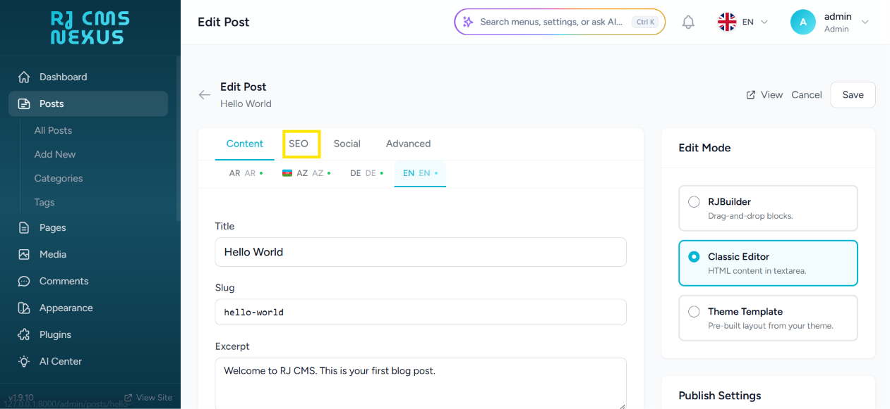
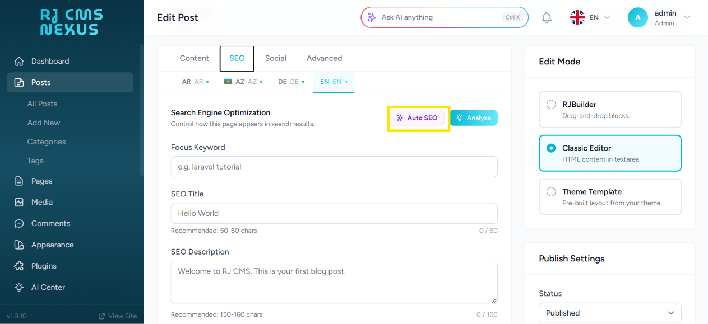
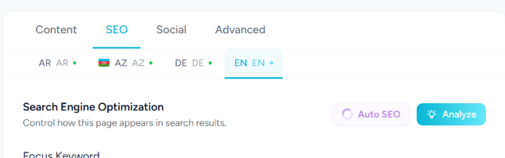
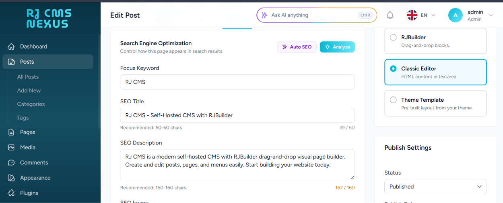
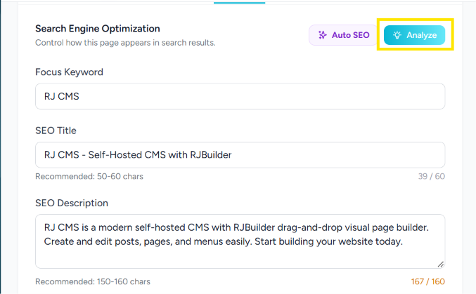

# Auto SEO (Posts & Pages)

RJ Nexus includes a built-in AI-powered SEO assistant that helps your content rank better in search engines. With one click it reads your content and writes the SEO metadata for you:

- **SEO Title:** the headline shown in search results.
- **SEO Description:** the short summary shown under the title.
- **Focus Keyword:** the main phrase your page should rank for.

**Posts and Pages share the exact same SEO logic**, so everything in this guide applies to both.

> **Video Guide:** Prefer a video walkthrough? [Watch the Auto SEO Tutorial on YouTube](https://www.youtube.com/watch?v=Q8vNMuH7yxQ).

---

## Before you start

Make sure these three things are ready, otherwise Auto SEO will not give good results:

- **AI is configured.** Auto SEO uses the AI connection from **Settings → AI**. If you have not set it up yet, follow the [AI Setup (OpenRouter)](#ai-setup) guide first.
- **Your page has real content.** The AI works only with the text on your page. The more useful text you write, the better the SEO data it can produce.
- **You know where Save is.** The **Save** button is at the top right of the edit screen. You will use it in Step 4.

---

## Step 1: Open the Edit Screen

Go to **Posts** (or **Pages**) in the admin sidebar. Find the item you want to optimize and click the **Edit** button.

---

## Step 2: Go to the SEO Tab

On the edit screen, find the tabs at the top of the content area and click **SEO**.

---

## Step 3: Run Auto SEO

Inside the SEO section, click the **Auto SEO** button.

**Please wait.** The AI reads all the content on your page to generate the most relevant SEO data. This can take a few moments. Do not close or refresh the page while the loading animation is active.

When it finishes, the AI fills in the **SEO Title**, **SEO Description** and **Focus Keyword** fields automatically, based on your content.

> **Tip:** If you already wrote your own SEO fields, copy them somewhere safe before running Auto SEO, because the AI can replace what is in those fields.

### Review the result

The AI gives you a strong starting point, but you know your content best. Take a minute to read each field and adjust it if needed:

- **SEO Title:** should describe the page clearly and contain your main keyword, ideally close to the beginning.
- **SEO Description:** should read like a short, natural invitation to click, not a list of keywords.
- **Focus Keyword:** should be the exact phrase people would type into a search engine to find this page.

---

## Step 4: Save Before You Analyze

This step is the one most people skip, and it is the most common reason for a strange score.

The **Analyze** feature checks the **saved data in the database**, not the temporary text you see in your browser. If you ran Auto SEO but have not saved yet, the analyzer is still looking at the old, empty fields and will show a very low score.

**Always click Save at the top right of the screen first.** Then run Analyze.

---

## Step 5: Analyze Your SEO

After saving, click the **Analyze** button to check how well the page is optimized.

The system checks your page against standard SEO rules and shows a score out of 100, with a list of things to fix.

---

## Understanding your score

### What the messages mean

Here are the messages you may see and how to fix each one:

- **"SEO title is too short (11 chars, aim for 50-60)."**
  Your title is too short to describe the page. Expand it so it explains what the page is about, and aim for 50 to 60 characters.

- **"SEO description is too short (48 chars, aim for 150-160)."**
  The description has room for more detail. Write one or two complete sentences that summarize the page and aim for 150 to 160 characters.

- **"Focus keyword is not set."**
  Enter the main phrase you want to rank for, or run Auto SEO again after saving your content.

- **"Content is very short (67 words, aim for 300+)."**
  The page does not have enough text. Add more useful information until the page reaches at least 300 words.

### Why is my score low? (for example 30/100)

A low score usually has one of two causes:

1. **The page content is too short.** Even though the AI generated the SEO data, it can only work with the text you provide. If your post or page has very little text, the AI cannot invent a 300+ word article. It creates the *best possible* metadata for the short content it has, and the analyzer will still flag the short content.
2. **The page was not saved.** If you did not click **Save** after running Auto SEO, the analyzer reads the old empty data. See [Step 4](#step-4-save-before-you-analyze).

---

## How to reach a high score

Follow this checklist for the best results:

1. Write at least **300 words** of helpful, original content.
2. Choose one clear **focus keyword** and use it naturally in the title, the description and the text.
3. Keep the **SEO title** between 50 and 60 characters.
4. Keep the **SEO description** between 150 and 160 characters.
5. Run **Auto SEO**, review the result, then click **Save**.
6. Click **Analyze** and fix anything still listed.
7. Save again after every change, then analyze again.

---

## Troubleshooting

- **Nothing happens when I click Auto SEO.**
  The AI may not be configured. Open **Settings → AI** and check that your API key and model are saved. See [AI Setup (OpenRouter)](#ai-setup).

- **I see an error message after clicking Auto SEO.**
  Common causes are an invalid API key, an empty credit balance on a paid model, or a busy free model. Try again after a minute, or choose another model in **Settings → AI**.

- **The fields stay empty or the result looks wrong.**
  The page may have too little text. Add more content, save, and run Auto SEO again.

- **The score is still low after I fixed everything.**
  Confirm that you clicked **Save** before clicking **Analyze**. The analyzer only sees saved data.

- **The loading takes very long.**
  Long pages and large models take more time. Wait for the animation to finish. If it never finishes, reload the page and try again, or switch to a faster model.

---

## Good to know

- Auto SEO is an assistant, not a replacement for good content. The best SEO result always comes from helpful, original text combined with accurate metadata.
- You can run Auto SEO as many times as you like. Each run uses your configured AI model, so a paid model uses a small amount of your OpenRouter credit.
- Posts and Pages work identically, so you can use the same steps for both.
