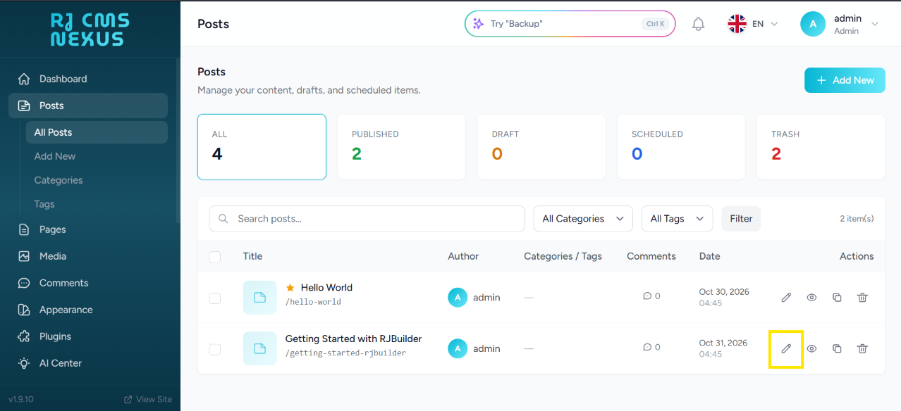
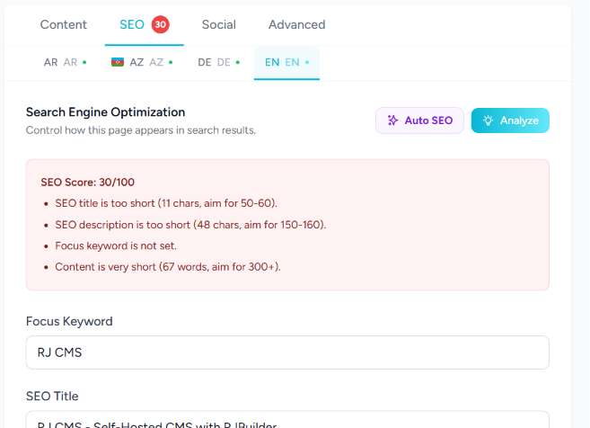

# Auto SEO (Posts & Pages)

RJ Nexus includes a built-in AI-powered SEO assistant to help your content rank better in search engines. **Posts and Pages share the exact same SEO logic**, so everything explained in this guide applies to both.

> **Video Guide:** Prefer a video walkthrough? [Watch the Auto SEO Tutorial on YouTube](https://www.youtube.com/watch?v=Q8vNMuH7yxQ).

---

## Step 1: Open the Edit Screen
Navigate to **Posts** (or **Pages**) from your admin sidebar. Find the item you want to optimize and click the **Edit** button.

---

## Step 2: Go to the SEO Tab
On the edit screen, locate the tabs at the top of the content area and click on **SEO**.

---

## Step 3: Run Auto SEO
Inside the SEO section, click the **Auto SEO** button.

**Please wait:** The AI will read through all the content on your page to generate the most relevant SEO data. This process may take a few moments, so do not close the page while the loading animation is active.

Once finished, the AI will automatically fill in the **SEO Title**, **SEO Description**, and **Focus Keyword** fields based on your content.

---

## Step 4: Analyze Your SEO
After the fields are filled, you can check how well your page is optimized by clicking the **Analyze** button.

### Why is my score low? (e.g., 30/100)
When you click Analyze, the system runs a check against standard SEO rules. You might see a result like this:

If your score is low (e.g., 30/100), it is usually because the content on the page is too short. For example, the analysis might report:
- *SEO title is too short (11 chars, aim for 50-60).*
- *SEO description is too short (48 chars, aim for 150-160).*
- *Focus keyword is not set.*
- *Content is very short (67 words, aim for 300+).*

**Explanation:** Even though the AI generated the SEO data, it can only work with the content you provide. If your actual post/page has very little text, the AI cannot magically create a 300+ word article for it. It generates the *best possible* metadata for the short content you have.

### ⚠️ Important: Save Before You Analyze
If you see an artificially low score, it is likely because **the page hasn't been saved yet**. 

The Analyze feature checks the **database**, not the temporary text in your browser. If you just ran Auto SEO but haven't clicked **Save** at the top right of the screen, the analyzer is still looking at the old, empty data. 

**Always click Save first**, then run Analyze to get an accurate score.
