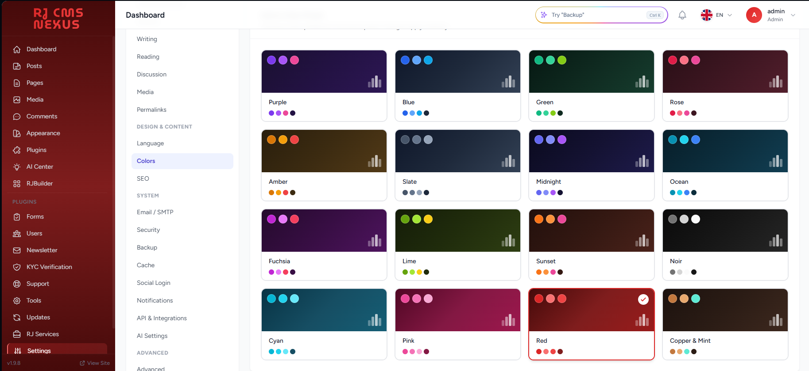

# 🎨 Developer: Custom Color Presets


> **✨ In one sentence:** add one array entry to `rj_color_presets()`, reload PHP, and your own admin color theme shows up in **Settings → Colors**.

Only want to change colors from the admin panel, with no code? Read the [Colors](colors.md) guide instead.

---

## 📑 On this page

- [Where presets live](#-where-presets-live)
- [Preset structure](#-preset-structure)
- [Color format](#-color-format)
- [Step by step](#-step-by-step)
- [Ready-to-use presets](#-ready-to-use-presets)
- [Set a preset from code](#-set-a-preset-from-code)
- [Updates will overwrite core files](#-updates-will-overwrite-core-files)
- [Troubleshooting](#-troubleshooting)

---

## 📍 Where presets live

Every color preset is defined in one place:

```
app/Helpers/rj.php  →  rj_color_presets()
```

Each **key** of the returned array is a *preset ID*. Each **value** is an array with a `label` and six RGB colors.

---

## 🧩 Preset structure

```php
'my-preset' => [
    'label'        => 'My Preset',
    'purple'       => 'R G B',
    'purple-light' => 'R G B',
    'pink'         => 'R G B',
    'dark-1'       => 'R G B',
    'dark-2'       => 'R G B',
    'dark-3'       => 'R G B',
],
```

### What each key controls

| | Key | CSS variable | Where it shows |
|:-:|-----|--------------|----------------|
| 🟣 | `purple` | `--rj-purple` | Primary buttons, active nav items, links |
| 💜 | `purple-light` | `--rj-purple-light` | Hover states, lighter accents |
| 🌸 | `pink` | `--rj-pink` | Secondary accent, gradient end |
| ⚫ | `dark-1` | `--rj-dark-1` | Main dark background |
| 🌑 | `dark-2` | `--rj-dark-2` | Slightly lighter surface |
| 🌒 | `dark-3` | `--rj-dark-3` | Card / panel surface |

> 🏷️ The `label` is the name shown in the picker. The array key (for example `my-preset`) is what gets stored in the `admin_color_preset` option.

> 📝 The key names say *purple* and *pink* for historical reasons. They simply mean **primary**, **primary (light)** and **secondary accent**, whatever the real color is.

---

## 🔢 Color format

Colors are **space-separated RGB integers (0–255)**. Not hex, not comma-separated, not `rgb()`.

```php
// ✅ Correct
'purple' => '124 58 237',

// ❌ Wrong, will not render
'purple' => '#7c3aed',
'purple' => '124,58,237',
'purple' => 'rgb(124,58,237)',
```

**Hex → RGB by hand:** split the hex into pairs and convert each one. `#7c3aed` → `7c`=124, `3a`=58, `ed`=237 → `124 58 237`.

**Hex → RGB with PHP:** paste this anywhere (a tinker session works too):

```php
[$r, $g, $b] = sscanf('#7c3aed', '#%02x%02x%02x');
echo "$r $g $b";   // 124 58 237
```

> 💡 **Tip:** keep `dark-1 < dark-2 < dark-3` in brightness. The admin uses them as background, surface and card, so the steps between them create the depth.

---

## 🚀 Step by step

### 1️⃣ Open the helper file

Open `app/Helpers/rj.php` and find the `rj_color_presets()` function.

### 2️⃣ Add your preset

Insert a new entry next to the existing ones:

```php
return [
    'purple' => [ /* ... */ ],

    // ... existing presets

    'ember' => [
        'label'        => 'Ember',
        'purple'       => '232 73 29',
        'purple-light' => '255 138 91',
        'pink'         => '13 148 136',
        'dark-1'       => '20 20 22',
        'dark-2'       => '33 33 36',
        'dark-3'       => '48 48 52',
    ],
];
```

### 3️⃣ Clear opcache

If PHP opcache is enabled, reload PHP-FPM (or clear opcache) so the new code is loaded.

| Hosting | What to do |
|---------|------------|
| Shared hosting | Saving the file is usually enough |
| VPS | `systemctl reload php8.2-fpm` (adjust the version) |

### 4️⃣ Select your preset

Open the admin panel → **Settings → Colors**. Your new preset now appears as a selectable card.

<p align="center">
  
  <br>
  <sub><i>Settings → Colors: every preset is a card with a live color preview.</i></sub>
</p>

Select it and save. Admin colors update immediately. 🎉

---

## 🎁 Ready-to-use presets

Four presets that look nothing like the built-in ones. Each uses a hue range and a background family that the others do not, so they are easy to tell apart in the picker. Copy any of them into `rj_color_presets()`.

| Preset | Idea | Primary | Light | Accent | Backgrounds |
|--------|------|:-------:|:-----:|:------:|:-----------:|
| **Ember** 🔥 | Vermilion on neutral charcoal, teal accent |  `#E8491D` |  `#FF8A5B` |  `#0D9488` |    |
| **Lime** 🍋 | Acid lime on olive-black, citrus accent |  `#65A30D` |  `#BEF264` |  `#FACC15` |    |
| **Fuchsia** 💖 | Neon magenta on plum-black, electric cyan accent |  `#C026D3` |  `#E879F9` |  `#22D3EE` |    |
| **Mono** 🩶 | Silver on pure neutral black, no hue at all |  `#71717A` |  `#D4D4D8` |  `#F4F4F5` |    |

<details>
<summary><b>📋 Copy the PHP for all four</b></summary>

```php
'ember' => [
    'label'        => 'Ember',
    'purple'       => '232 73 29',
    'purple-light' => '255 138 91',
    'pink'         => '13 148 136',
    'dark-1'       => '20 20 22',
    'dark-2'       => '33 33 36',
    'dark-3'       => '48 48 52',
],
'lime' => [
    'label'        => 'Lime',
    'purple'       => '101 163 13',
    'purple-light' => '190 242 100',
    'pink'         => '250 204 21',
    'dark-1'       => '14 18 6',
    'dark-2'       => '26 33 10',
    'dark-3'       => '38 48 15',
],
'fuchsia' => [
    'label'        => 'Fuchsia',
    'purple'       => '192 38 211',
    'purple-light' => '232 121 249',
    'pink'         => '34 211 238',
    'dark-1'       => '24 6 30',
    'dark-2'       => '40 10 52',
    'dark-3'       => '58 14 74',
],
'mono' => [
    'label'        => 'Mono',
    'purple'       => '113 113 122',
    'purple-light' => '212 212 216',
    'pink'         => '244 244 245',
    'dark-1'       => '10 10 12',
    'dark-2'       => '24 24 27',
    'dark-3'       => '39 39 42',
],
```

</details>

---

## ⚡ Set a preset from code

To activate a preset without touching the UI:

```php
rj_set_option('admin_color_preset', 'ember');
rj_flush_options();
```

The admin panel uses the new colors on the next request.

---

## ⚠️ Updates will overwrite core files

`app/Helpers/rj.php` is part of the core. When you update RJ Nexus this file is replaced, and **your custom preset will be lost**.

| Option | How |
|--------|-----|
| 📎 **Keep a snippet** | Store your preset code outside the project and re-add it after each update |
| 🌿 **Use a branch** | Keep your edits in a fork or a private branch |
| 🤝 **Send a pull request** | If the preset is useful to everyone, submit it to [rj-nexus/rj-nexus](https://github.com/rj-nexus/rj-nexus) so it ships in the next release |

> 💡 `rj-content/themes/` and `rj-content/plugins/` are never touched by core updates. A small plugin or a theme README is a safe place to keep your preset snippet.

---

## 🛠️ Troubleshooting

| Symptom | Likely cause | Fix |
|---------|--------------|-----|
| Preset does not appear in **Settings → Colors** | Old code is cached by opcache | Reload PHP-FPM or clear opcache |
| Colors look broken or unchanged | A color is not in `R G B` format | Use space-separated integers, never hex or `rgb()` |
| Admin falls back to purple | The saved preset ID no longer exists | Pick a preset again in **Settings → Colors** or call `rj_set_option()` with a valid ID |
| Preset vanished after an update | `rj.php` was replaced by the new version | Re-add your entry (see the section above) |
| Text is hard to read on buttons | `purple` is too light for white text | Use a darker primary and keep the light shade in `purple-light` |

---

## 🔗 Related

- 📘 [Colors](colors.md): end-user guide for changing admin, frontend and theme colors from the UI
