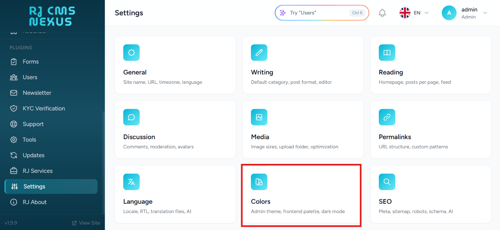
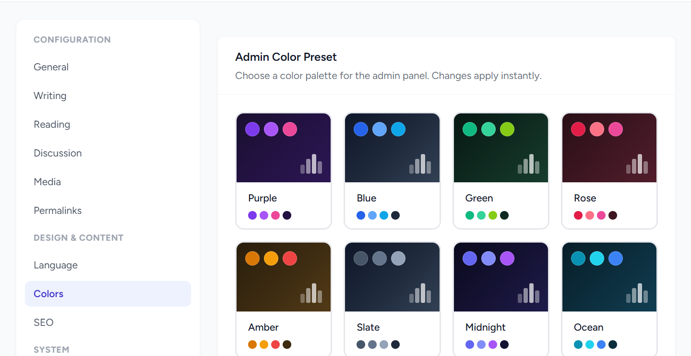
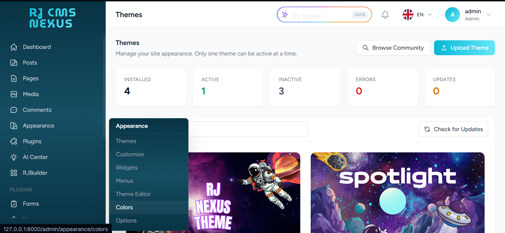
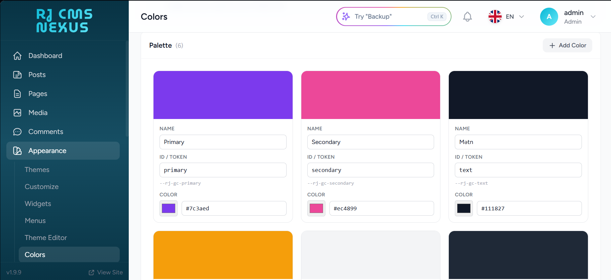
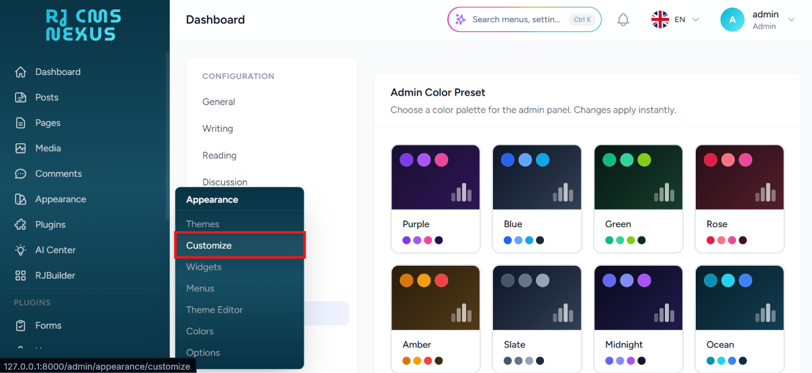
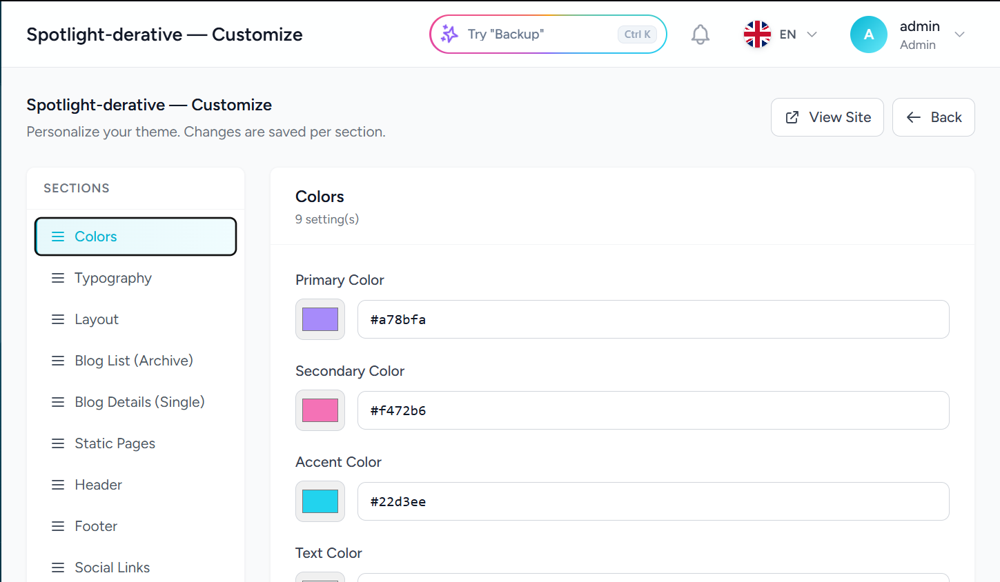

# Colors

RJ Nexus lets you change colors in three separate places, each controlling a different part of the system. Pick the one that matches what you want to change.

| What you want to change | Where to go |
|---|---|
| Admin panel look (sidebar, buttons, links) | **Settings → Colors** |
| Frontend site colors (visitors see these) | **Appearance → Colors** |
| Theme-specific colors (if the active theme supports them) | **Appearance → Customize** |

---

## 1. Admin Panel Colors

These colors control the appearance of the admin panel itself - the sidebar, primary buttons, links, and gradient accents. They do not affect the frontend.

**Step 1** — From the sidebar open **Settings**, then locate the **Colors** card in the settings grid.

**Step 2** — Choose a preset or adjust individual colors. Changes apply to the admin panel immediately after saving.

---

## 2. Frontend Site Colors

These colors are the ones visitors see on your public site - links, buttons, and global accent colors shared by every theme.

**Step 1** — From the sidebar open **Appearance**, then click **Colors**.

**Step 2** — Select a global color preset or fine-tune the individual values. These act as the base palette for the frontend.

---

## 3. Theme Colors

Some themes provide their own dedicated color controls, independent of the global frontend colors above. If your active theme supports customization, you can override its colors from the theme customizer. These settings apply only to the active theme.

**Step 1** — From the sidebar open **Appearance**, then click **Customize** for the active theme.

**Step 2** — Open the **Colors** section of the customizer and adjust the theme-specific values. Each control maps directly to a CSS variable used by the theme.

---

## Which one should I use?

- To rebrand the **admin panel**, use **Settings → Colors**.
- To change the **frontend base palette** across all themes, use **Appearance → Colors**.
- To tweak colors for the **currently active theme only**, use **Appearance → Customize** (only if the theme exposes color controls).
- If both *Appearance → Colors* and the theme customizer are set, the theme customizer values win — they are more specific.
