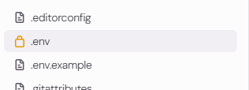
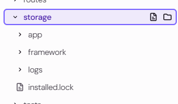
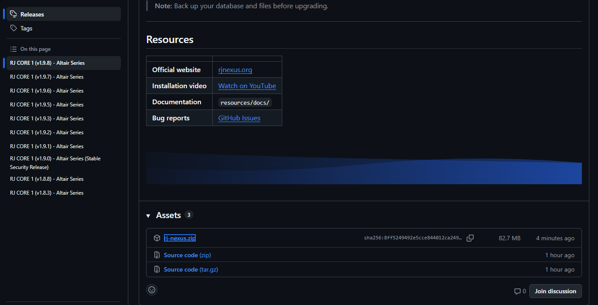
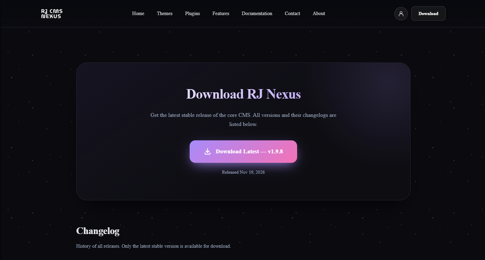
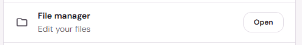
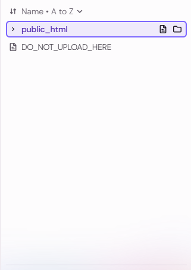
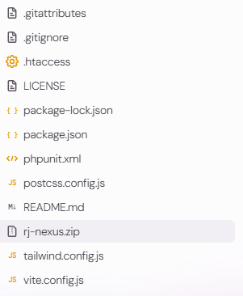
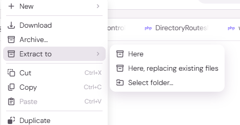
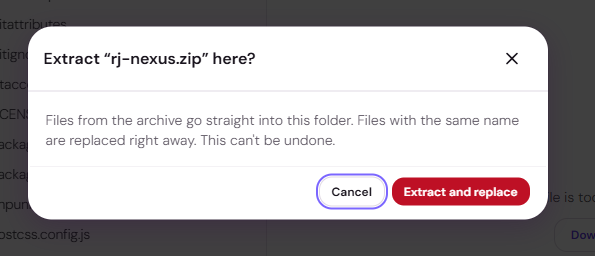

# Manual Update

This guide shows how to update RJ Nexus manually, without any command line. It covers **Hostinger (hPanel)** and **cPanel**. The process is the same on both: download the new version, upload it, extract it over the old files, and keep two protected files untouched.

> 🎥 **Prefer video?** Watch the full walkthrough: [Manual Update on YouTube](https://www.youtube.com/watch?v=K8u58uzBn34)

---

## Before You Start

- Create a **backup** of your site files and database (hosting panel → Backups).
- Make sure you know where your site lives. On most hosts it is the `public_html` folder.
- Read the warning below. It is the most important part of this guide.

> ## ⛔ DO NOT DELETE THESE FILES
>
> Your site will break or ask for a fresh installation if either of them is lost.
>
> | File | Location | Why it matters |
> |------|----------|----------------|
> | `.env` | `public_html/.env` | Holds your database connection, app key and all settings |
> | Installed lock file | inside `public_html/public/` | Tells the system it is already installed, so the installer does not run again |
>
> Never delete, rename or replace them. If you remove old files before extracting, **skip these two**.

**`.env` location:**

**Installed lock file location:**

---

## Step 1: Download the Latest Version

Choose **one** of the two sources.

### Option A: GitHub

Open the releases page: <https://github.com/rj-nexus/rj-nexus/releases>

Find the latest release and download the source/package `.zip` file.

### Option B: Official Website

Open the official website: <https://rjnexus.org/en/download>

**1. Click the Download button in the header.**

**2. On the Download page, pick the latest version and download the ZIP file.**

Keep the downloaded `.zip` file. **Do not extract it on your computer.**

---

## Update on Hostinger (hPanel)

### Step 1: Open File Manager

Log in to hPanel, select your website, and open **File Manager**.

Then open the `public_html` folder, where your site files are.

> Remember: do **not** delete `.env` or the installed lock file.

### Step 2: Upload the ZIP File

Click the **Upload** button and select the `.zip` file you downloaded. Wait until the upload reaches 100%.

### Step 3: Extract the ZIP

Right-click the uploaded `.zip` file and choose **Extract**. Extract it into `public_html` so the new files overwrite the old ones.

### Step 4: Replace Existing Files

If the File Manager asks about existing files, choose **Replace / Overwrite**, so the old files are updated with the new version.

After the extraction finishes, delete the uploaded `.zip` file to keep your hosting clean.

---

## Update on cPanel

The idea is exactly the same as on Hostinger. Only the interface looks different.

1. **Log in to cPanel** and open **File Manager** (under *Files*).
2. Go to the folder where your site is installed, usually `public_html`.
3. Click **Upload** at the top, then drag and drop the `.zip` file. Wait for it to finish, then click **Go Back**.
4. Reload the folder (the **Reload** button) so the `.zip` file appears in the list.
5. Right-click the `.zip` file and choose **Extract**. Make sure the extraction path is `/public_html` (or your site's folder), then click **Extract File(s)**.
6. cPanel overwrites files with the same name automatically. Your `.env` and installed lock file are not part of the package, so they stay untouched, but **never delete them by hand**.
7. When extraction is done, delete the `.zip` file.

> **Tip:** If the new files extracted into an extra subfolder (for example `rj-nexus-1.2.3/`), open that folder, select all files, and **Move** them into `public_html`, choosing to overwrite. Then delete the empty folder.

---

## After the Update

1. Open your website and the admin panel to confirm everything loads.
2. Clear your site cache (from the admin panel if available) and your browser cache (`Ctrl + F5`).
3. Check the version number in the admin panel to confirm the update was applied.

## Troubleshooting

| Problem | Solution |
|---------|----------|
| Installer screen appears again | The installed lock file was deleted. Restore it from your backup. |
| Database / 500 error after update | The `.env` file was removed or replaced. Restore it from your backup. |
| Old design still visible | Clear site cache and browser cache. |
| Files not overwritten | Extract again and choose **Replace / Overwrite**. |

---

## Need Hosting?

RJ Nexus is an open-source project. If you are looking for reliable hosting, you can get **20% off Hostinger** with our referral link. It also helps support the project at no extra cost to you:

👉 [Get Hostinger with 20% discount](https://www.hostinger.com?REFERRALCODE=PGIMRPOKHRWS)
