# Languages & Translation

RJ Nexus allows you to manage multiple languages, change the admin and frontend locales, translate your content, and fully customize the translation strings. This guide covers everything from adding a new language to using the built-in translation editor.

---

## 1. Accessing Language Settings

**Step 1** — From the admin sidebar, navigate to **Settings**.

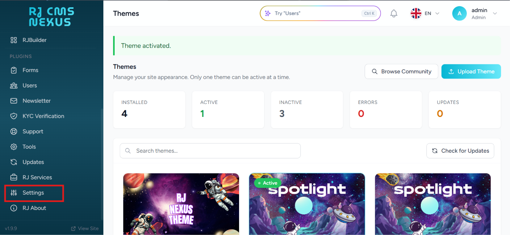

**Step 2** — In the settings grid, locate and click on the **Language** card.

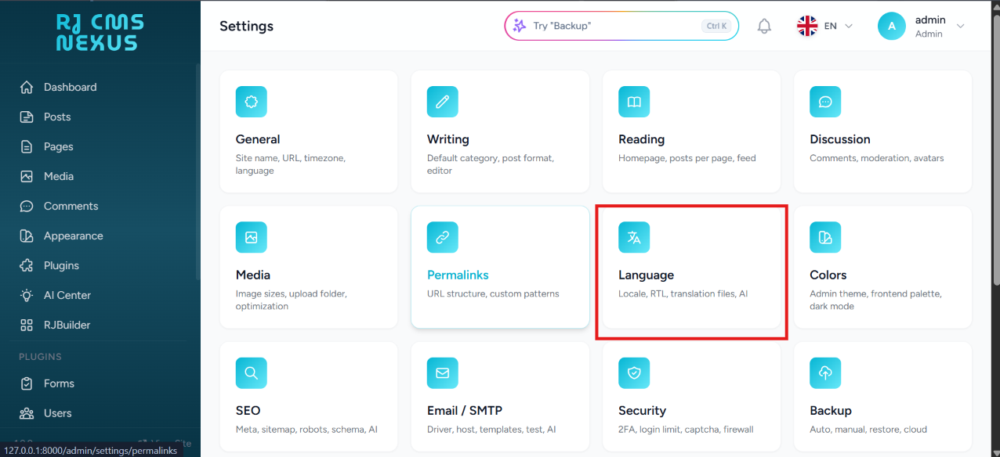

**Step 3** — This opens the main Language management screen.

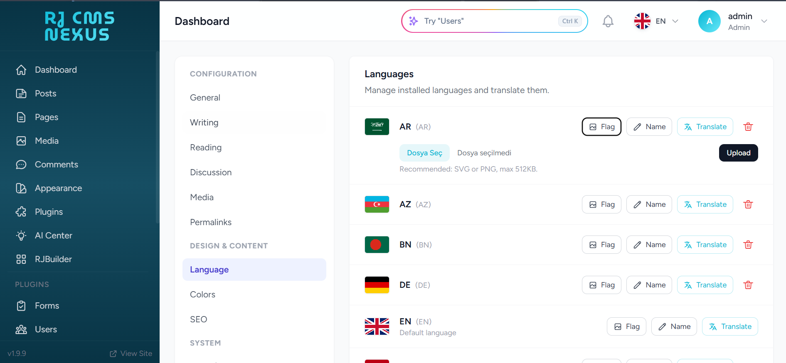

---

## 2. General Language Settings

At the bottom of the Language screen, you will find the core configuration options.

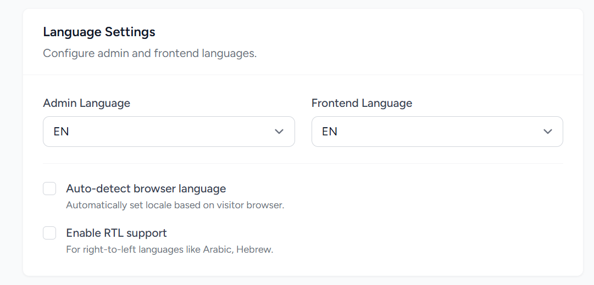

- **Admin Language:** Sets the default language for your admin panel.
- **Frontend Language:** Sets the default fallback language for your public site.
- **Auto-detect browser language:** If enabled, the system automatically sets the locale based on the visitor's browser language.
- **Enable RTL support:** Automatically applies Right-to-Left layout direction for languages like Arabic, Hebrew, Persian, and Urdu.

---

## 3. Managing Languages

### Add a New Language
You can add a new language to the system by clicking the **Add Language** button.
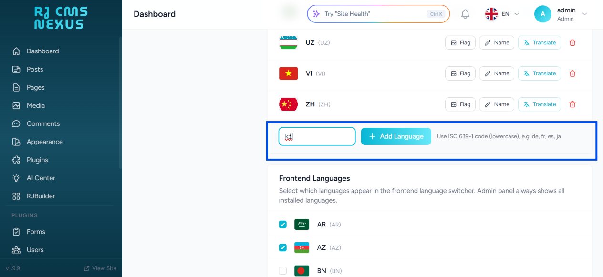

### Select Frontend Languages
Choose which languages are visible to your visitors on the frontend. Only the selected languages will appear in the frontend language switcher.
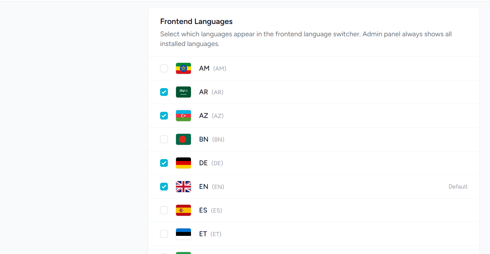

### Edit Language Name
You can rename the languages to fit your site's needs.
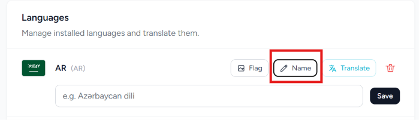

### Change Language Flag
You can change the country flag associated with a language by uploading a new icon.
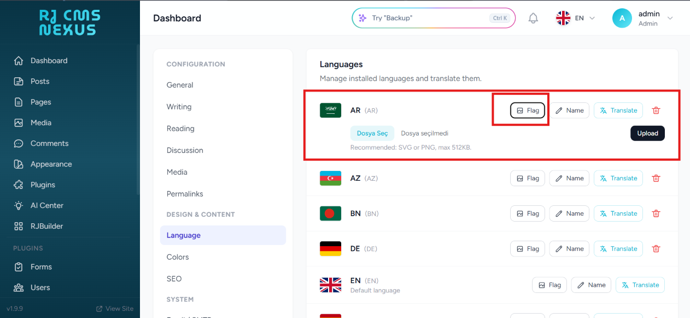

### Delete a Language
System languages can be deleted using the trash icon next to the language.
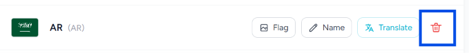

---

## 4. Using the Translation Editor

To translate the static strings (UI text) of your site, click the **Translate** button next to any language.

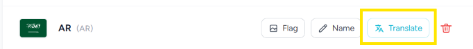

### AI Translation Setup
At the bottom of the language settings, you will find the AI Translation option. 
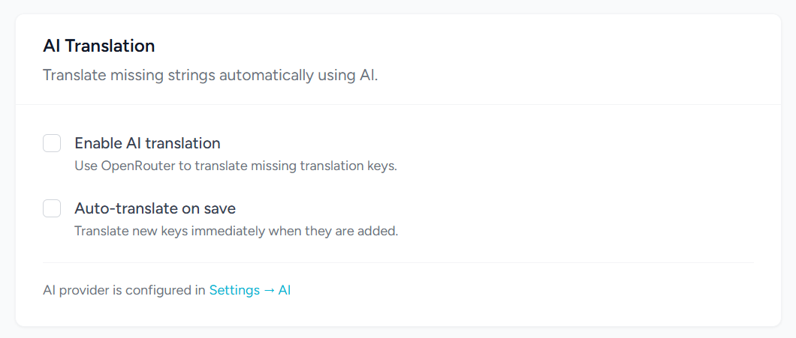

> **Important:** The Auto Translate feature requires an OpenRouter API key to function. If you haven't set it up yet, follow the [AI Setup (OpenRouter)](#ai-setup) guide.

### The Translation Screen
When you open the translation editor, you will see a detailed interface. Here is a breakdown of the 5 colored areas:

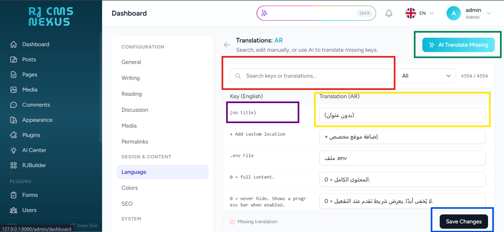

1. **Green Box (Auto Translate):** Click this to automatically translate missing strings using AI. *(Requires OpenRouter setup)*.
2. **Red Box (Search):** Use this search bar to find specific keys or translations. You can search in any language to quickly locate and edit a string.
3. **Purple Box (Keys):** These are the original strings or keys that need to be translated (usually in English).
4. **Yellow Box (Strings):** This is where the actual translation goes. Edit the text here to change what the user sees.
5. **Blue Button (Save):** Click this button to save all your changes to the translation files.
